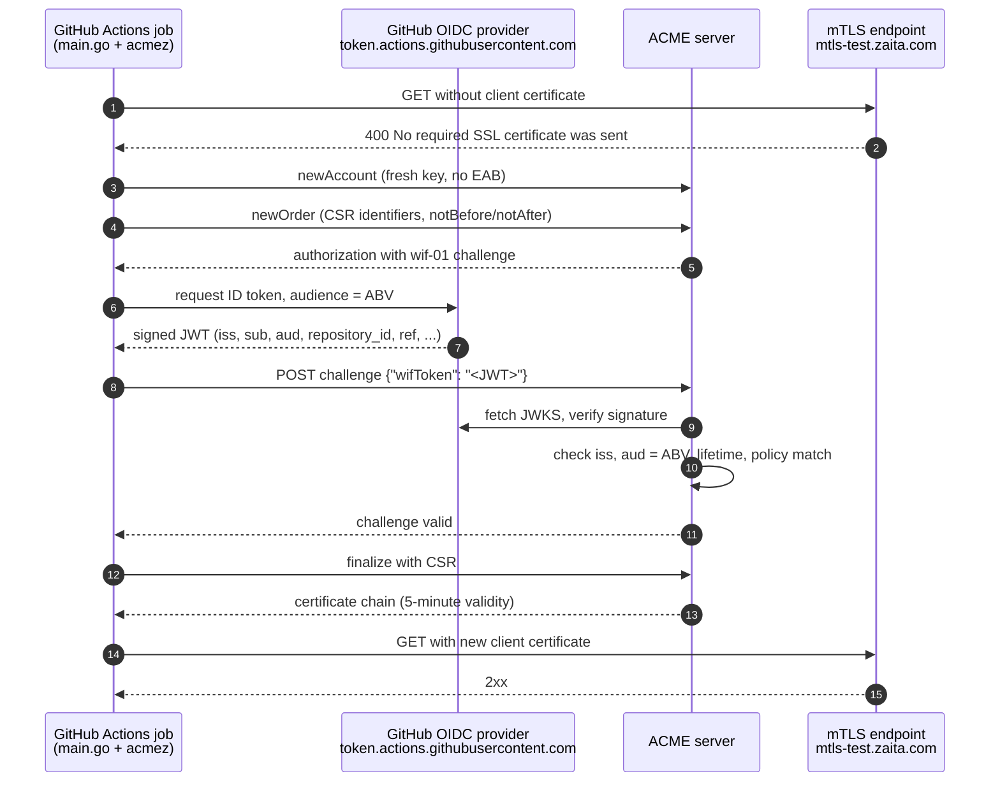
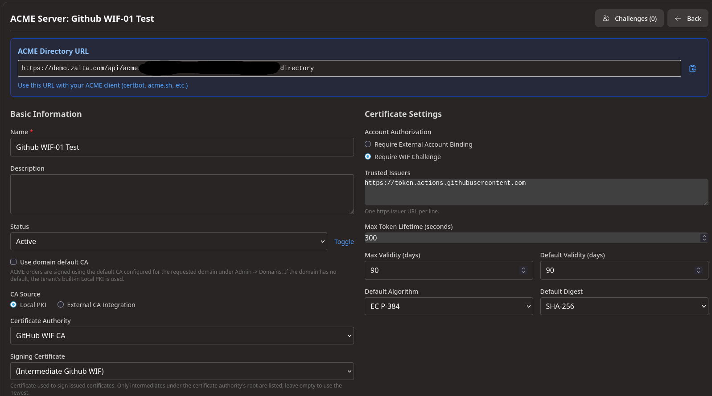
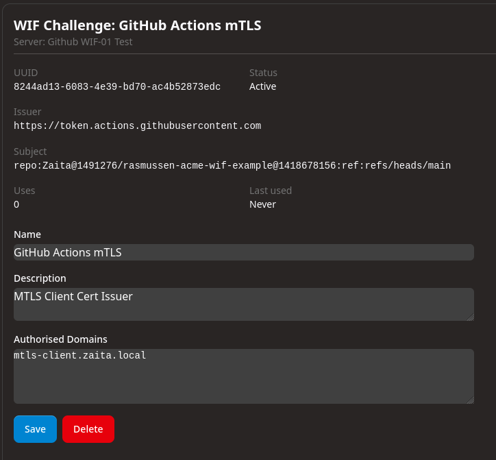

# rasmussen-acme-wif-example

An example GitHub Actions workflow that obtains a TLS certificate with the ACME
`wif-01` challenge from
[draft-rasmussen-acme-wif](https://datatracker.ietf.org/doc/draft-rasmussen-acme-wif/).
The job proves control of its identifiers by presenting its own GitHub Actions
OIDC token. It needs no DNS or HTTP validation and no External Account Binding
secret.

The client is a small Go program ([main.go](main.go)) built on the
[`wif-01` branch of acmez](https://github.com/Zaita/acmez/tree/wif-01), which
`go.mod` pulls in through a `replace` directive.

The example issues a five-minute certificate and uses it straight away as an
mTLS client certificate against https://mtls-test.zaita.com. The certificate
works as a short-lived credential that exists only for the length of the job.

## Background: what `wif-01` changes

ACME (RFC 8555) normally asks a client to prove control of an identifier by
publishing a value in DNS (`dns-01`) or on a web server (`http-01`). Neither
fits a CI job well. The job has no web server reachable from the CA, and
granting it DNS write access gives it far more power than it needs. CAs that
want to restrict who can register an account add External Account Binding
(EAB), which is a long-lived secret that has to be stored somewhere.

Workload Identity Federation (WIF) takes a different route. The workload
already has a signed identity document: GitHub Actions issues each job an
OIDC JSON Web Token that states which repository, branch, workflow and run it
belongs to. With `wif-01`, the ACME server:

1. trusts one or more OIDC issuers (here `https://token.actions.githubusercontent.com`);
2. keeps a policy that maps workload identities (token claims) to the
   identifiers each one may obtain; and
3. accepts a token as the challenge response when it is signed by a trusted
   issuer, is bound to this specific challenge, and matches a policy entry
   that authorises the requested identifier.

The token is bound to the challenge through its `aud` (audience) claim. The
client sets `aud` to the challenge's **Audience Binding Value**:

```
urn:ietf:params:acme:wif:<base64url(SHA-256(keyAuthorization))>
```

The `keyAuthorization` combines the challenge token with the ACME account key
thumbprint. A token minted for one challenge and account cannot be replayed
against another.

## End-to-end flow



## Configuring the ACME server

The CA side needs two things: an ACME server (directory) that requires the
WIF challenge and trusts GitHub as an issuer, and a policy entry for this
workflow.

### 1. ACME server



The relevant settings:

- **Account Authorization: Require WIF Challenge.** Accounts are not
  pre-authorised through EAB. Authority comes entirely from the workload's
  token at challenge time.
- **Trusted Issuers: `https://token.actions.githubusercontent.com`.** The
  server accepts only tokens signed by GitHub Actions' OIDC provider, verified
  against the issuer's published JWKS.
- **Max Token Lifetime: 300 seconds.** Tokens with a longer lifetime are
  rejected, which limits how long a leaked token is useful.
- **Certificate Authority / Signing Certificate.** Certificates come from a
  dedicated "GitHub WIF" intermediate. Relying parties can trust that
  intermediate for CI-issued client certificates without trusting anything
  else the CA issues.
- **Max / Default Validity.** These set the upper bound. The workflow asks
  for a much shorter lifetime through the order's `notBefore`/`notAfter`, and
  the job fails if the CA does not honour it.

The **ACME Directory URL** shown at the top is the value to put in
`ACME_DIRECTORY_URL`.

### 2. WIF challenge policy



Each policy entry ties a workload identity to the identifiers it may obtain:

- **Issuer:** the OIDC issuer the token must come from.
- **Subject:** the token's `sub` claim that must match. The example is
  `repo:Zaita@1491276/rasmussen-acme-wif-example@1418678156:ref:refs/heads/main`.
  It includes the owner and repository **IDs** as well as their names, so a
  renamed or re-created repository with the same name cannot inherit this
  policy, and it pins the workflow to the `main` branch. This follows
  Appendix A.1 of the draft: match `repository_id` and `repository_owner_id`
  rather than the mutable names, and constrain `ref` or `environment`.
- **Authorised Domains:** the identifiers this workload may request. An order
  for anything else is refused even if the token is valid.
- **Uses / Last used:** an audit trail of how often the policy has been
  exercised.

## The GitHub Action, step by step

The workflow ([.github/workflows/acme-wif.yml](.github/workflows/acme-wif.yml))
is deliberately small:

```yaml
permissions:
  contents: read
  id-token: write # lets the job request OIDC tokens for the wif-01 challenge
```

`id-token: write` is the only special permission. It allows the job to call
the runner's `ACTIONS_ID_TOKEN_REQUEST_URL` endpoint and mint OIDC tokens with
an audience of its choosing. No repository secrets are used.

| Step | What it does |
|---|---|
| `actions/checkout@v5` | Checks out this repository (`main.go`, `go.mod`). |
| `actions/setup-go@v6` | Installs the Go version named in `go.mod`. |
| `Obtain certificate` (`go run .`) | Runs the client, which does all of the ACME and mTLS work below. |

Inside `go run .` ([main.go](main.go)):

1. **Baseline mTLS check.** If `MTLS_TEST_URL` is set, the job sends a request
   without a client certificate and requires it to fail. For
   https://mtls-test.zaita.com the response is
   `400 No required SSL certificate was sent`. Without this check, the later
   success would not prove that the certificate was what granted access.
2. **Directory discovery.** The client fetches the ACME directory and warns if
   it does not advertise `wif-01` support (`meta.wif`) or does not list the
   GitHub issuer.
3. **Ephemeral account.** A fresh P-256 ACME account key is generated on every
   run and an account is registered with no EAB (draft §5.1, §5.3). The
   account holds no authority of its own. Authority comes from the OIDC token
   presented for each authorization.
4. **Key and CSR.** A separate P-256 certificate key is generated in memory
   and a CSR is built from the `CSR_*` variables. The common name is also
   added as a SAN, because the order's identifiers come from the SANs.
5. **Short-lived order.** The order requests `notBefore` = now and
   `notAfter` = now + `CERT_LIFETIME` (5 minutes by default).
6. **`wif-01` challenge.** For each authorization, acmez computes the Audience
   Binding Value from the key authorization, requests an OIDC token from the
   runner with that `aud`, and posts it as `{"wifToken": "..."}`. The CA
   verifies the token and checks it against its policy.
7. **Finalize and download.** Once the authorizations are valid, the order is
   finalized and the certificate chain is downloaded and printed to the log.
   The private key is never printed or written to disk.
8. **Lifetime check.** The job fails if the issued certificate is valid for
   more than `CERT_LIFETIME` plus one minute of allowance for clock skew.
9. **mTLS with the new certificate.** The job repeats the request to
   `MTLS_TEST_URL`, this time with the issued certificate as its TLS client
   certificate, and requires a 2xx response.
10. **Job summary.** The baseline and mTLS results and the certificate chain
    are written to the run's job summary (`GITHUB_STEP_SUMMARY`).

When the job ends, the runner is torn down and the private key is gone with
it. Within minutes the certificate has expired as well.

## Benefits of this approach

- **No stored secrets.** No EAB key, DNS API token or client certificate is
  kept in GitHub secrets. Nothing long-lived can leak from the repository or
  its logs.
- **Identity based on what the workload is.** Authorization depends on
  verifiable facts about the job (repository ID, owner ID, branch or
  environment), signed by GitHub, not on possession of a shared secret.
- **Narrow, auditable policy.** Each policy entry authorises one workload for
  a specific set of identifiers. Revoking access means deleting or disabling
  the entry, not rotating secrets across systems, and the CA records every use.
- **Replay-resistant.** The token's audience is bound to a single challenge
  and account key, and the CA enforces a short token lifetime. An intercepted
  token cannot be used for another order.
- **Short-lived credentials.** A five-minute certificate needs no revocation
  infrastructure in practice. If it leaks, it expires before it can be put to
  much use. Each run gets its own key and certificate, so nothing is shared
  between runs.
- **No validation infrastructure.** No public DNS records to write and no
  HTTP endpoint to expose. The CA can issue for internal names that are not
  publicly resolvable.
- **Standard ACME.** WIF is one more challenge type, so existing ACME
  libraries and CAs only need the `wif-01` solver and validator. Orders,
  finalization and certificate formats are unchanged.
- **Separable trust.** Issuing from a dedicated intermediate lets relying
  parties (such as the mTLS endpoint here) accept only certificates that came
  through this WIF flow.

## Configuration

Edit the values in [.github/workflows/acme-wif.yml](.github/workflows/acme-wif.yml):

| Variable | Description |
|---|---|
| `ACME_DIRECTORY_URL` | Required. The CA's ACME directory URL |
| `ACME_CONTACT_EMAIL` | Optional account contact |
| `CSR_COMMON_NAME` | Subject CN; also requested as a SAN |
| `CSR_DNS_NAMES`, `CSR_IP_ADDRESSES` | Comma-separated SANs |
| `CERT_LIFETIME` | Requested validity as a Go duration (default `5m`) |
| `MTLS_TEST_URL` | Optional. An mTLS endpoint used to test the issued certificate |
| `CSR_ORGANIZATION`, `CSR_ORGANIZATIONAL_UNIT`, `CSR_COUNTRY`, `CSR_PROVINCE`, `CSR_LOCALITY` | Optional Subject fields |

Every requested identifier must be listed in the policy entry's
**Authorised Domains**.

Run it from the **Actions** tab (`workflow_dispatch`). The job needs
`permissions: id-token: write`, which the workflow already sets.

## CA requirements

The ACME server must:

- support `wif-01` and accept the issuer `https://token.actions.githubusercontent.com`;
- have a policy entry that permits this workflow to obtain the requested
  identifiers. Per Appendix A.1 of the draft, match `repository_id` and
  `repository_owner_id` rather than the mutable names, and constrain `ref`
  or `environment`.
