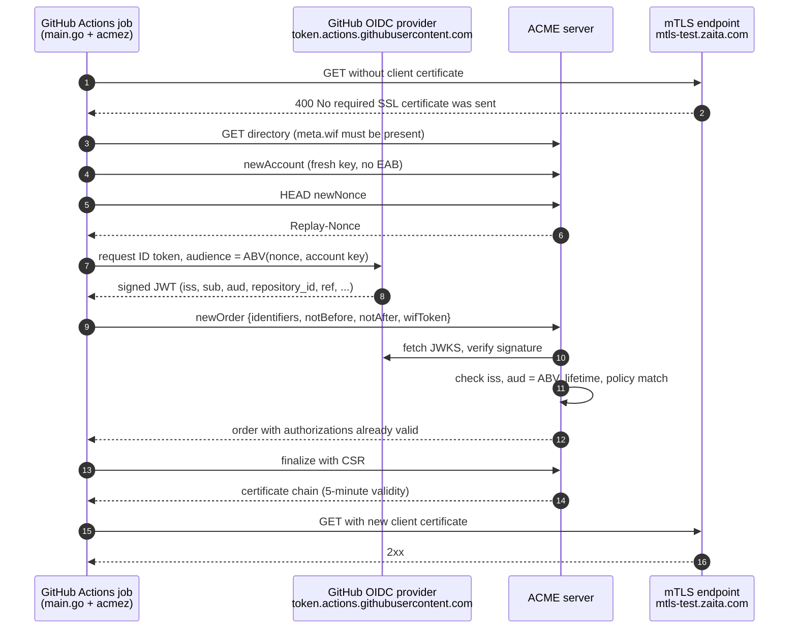
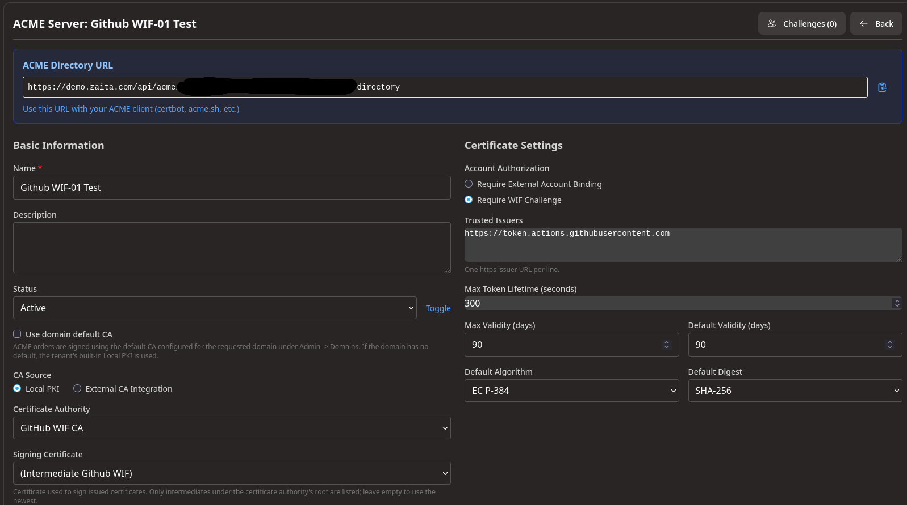
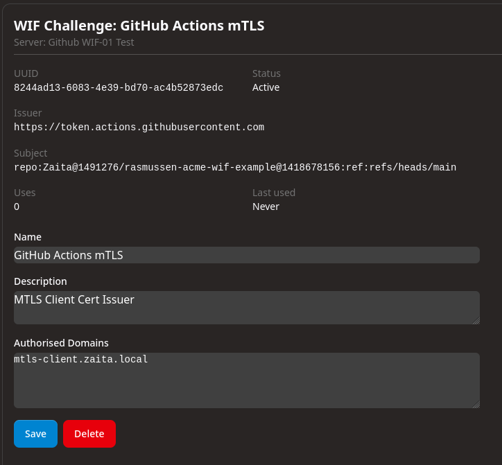

# rasmussen-acme-wif-example

An example GitHub Actions workflow that obtains a TLS certificate with ACME
Workload Identity Federation (WIF), as specified in
[draft-rasmussen-acme-wif-01](https://datatracker.ietf.org/doc/draft-rasmussen-acme-wif/01/).
The job sends its own GitHub Actions OIDC token with the ACME order, and the
CA pre-authorizes the identifiers its policy grants to this workflow. It needs
no DNS or HTTP validation and no External Account Binding secret.

The client is a small Go program ([main.go](main.go)) built on the
[Zaita fork of acmez](https://github.com/Zaita/acmez), which `go.mod` pulls in
through a `replace` directive.

The example issues a five-minute certificate and uses it straight away as an
mTLS client certificate against https://mtls-test.zaita.com. The certificate
works as a short-lived credential that exists only for the length of the job.

> **Draft -01.** Draft -00 defined a `wif-01` challenge. Draft -01 removed it:
> the token now travels in the newOrder request, and its audience is bound to
> that request's nonce instead of a challenge's key authorization. This
> example and the acmez fork implement -01 only.

## Background: what WIF changes

ACME (RFC 8555) normally asks a client to prove control of an identifier by
publishing a value in DNS (`dns-01`) or on a web server (`http-01`). Neither
fits a CI job well. The job has no web server reachable from the CA, and
granting it DNS write access gives it far more power than it needs. CAs that
want to restrict who can register an account add External Account Binding
(EAB), which is a long-lived secret that has to be stored somewhere.

Workload Identity Federation takes a different route. The workload already
has a signed identity document: GitHub Actions issues each job an OIDC JSON
Web Token that states which repository, branch, workflow and run it belongs
to. With WIF, the ACME server:

1. advertises WIF support in its directory (`meta.wif`) and trusts one or more
   OIDC issuers (here `https://token.actions.githubusercontent.com`);
2. keeps a policy that maps workload identities (token claims) to the
   identifiers each one may obtain; and
3. accepts a `wifToken` in the newOrder request. If the token is signed by a
   trusted issuer, is bound to this request, and matches a policy entry that
   authorises the requested identifiers, the server creates those
   authorizations already `valid`, with no challenge to complete.

This is pre-authorization by CA policy, like EAB, but the authority comes from
a short-lived, per-order token rather than a stored secret.

The token is bound to the request through its `aud` (audience) claim. The
client sets `aud` to the request's **Audience Binding Value** (ABV):

```
urn:ietf:params:acme:wif:<base64url(SHA-256(nonce "." accountKeyThumbprint))>
```

`nonce` is the replay nonce in the newOrder request's JWS header, and
`accountKeyThumbprint` is the RFC 7638 thumbprint of the account key that
signs it. The server issues each nonce only once, and the token is bound to
the account key. A token minted for one request therefore cannot be replayed
with another request or by another account. A new token is obtained for every
order, and for every retry after a `badNonce` error.

## End-to-end flow



## Configuring the ACME server

The CA side needs two things: an ACME server (directory) that requires WIF and
trusts GitHub as an issuer, and a policy entry for this workflow.

The screenshots below are from the Zaita CLM. They were taken while the CLM
used draft -00, so some labels still say "WIF-01" or "WIF Challenge". The
settings mean the same under -01.

### 1. ACME server



The relevant settings:

- **Account Authorization: Require WIF Challenge.** Accounts are not
  pre-authorised through EAB. Authority comes entirely from the workload
  token sent with each order. The directory advertises `meta.wif` with
  `required: true`, so an order without a token is refused with
  `unauthorized`.
- **Trusted Issuers: `https://token.actions.githubusercontent.com`.** The
  server accepts only tokens signed by GitHub Actions' OIDC provider, verified
  against the issuer's published JWKS. These appear in the directory as
  `meta.wif.issuers`.
- **Max Token Lifetime: 300 seconds.** Tokens with a longer remaining
  lifetime are rejected, which limits how long a leaked token is useful.
  This appears in the directory as `meta.wif.maxTokenLifetime`.
- **Certificate Authority / Signing Certificate.** Certificates come from a
  dedicated "GitHub WIF" intermediate. Relying parties can trust that
  intermediate for CI-issued client certificates without trusting anything
  else the CA issues.
- **Max / Default Validity.** These set the upper bound. The workflow asks
  for a much shorter lifetime through the order's `notBefore`/`notAfter`, and
  the job fails if the CA does not honour it.

The **ACME Directory URL** shown at the top is the value to put in
`ACME_DIRECTORY_URL`.

### 2. WIF policy entry



Each policy entry ties a workload identity to the identifiers it may obtain:

- **Issuer:** the OIDC issuer the token must come from.
- **Subject:** the token's `sub` claim that must match. The example is
  `repo:Zaita@1491276/rasmussen-acme-wif-example@1418678156:ref:refs/heads/main`.
  It includes the owner and repository **IDs** as well as their names, so a
  renamed or re-created repository with the same name cannot inherit this
  policy, and it pins the workflow to the `main` branch. This follows
  Appendix A of the draft: match `repository_id` and `repository_owner_id`
  rather than the mutable names, and constrain `ref` or `environment`.
- **Authorised Domains:** the identifiers this workload may request. An
  identifier outside this list is not pre-authorized, and this example has
  no challenge solver to fall back on, so the order fails.
- **Uses / Last used:** an audit trail of how often the policy has been
  exercised.

## The GitHub Action, step by step

The workflow ([.github/workflows/acme-wif.yml](.github/workflows/acme-wif.yml))
is deliberately small:

```yaml
permissions:
  contents: read
  id-token: write # lets the job request the OIDC token it sends with the ACME order
```

`id-token: write` is the only special permission. It allows the job to call
the runner's `ACTIONS_ID_TOKEN_REQUEST_URL` endpoint and mint OIDC tokens with
an audience of its choosing. No repository secrets are used.

| Step | What it does |
|---|---|
| `actions/checkout@v5` | Checks out this repository (`main.go`, `go.mod`). |
| `actions/setup-go@v6` | Installs the Go version named in `go.mod`. |
| `Obtain certificate` (`go run .`) | Runs the client, which does all of the ACME and mTLS work below. |

Inside `go run .` ([main.go](main.go)):

1. **Baseline mTLS check.** If `MTLS_TEST_URL` is set, the job sends a request
   without a client certificate and requires it to fail. For
   https://mtls-test.zaita.com the response is
   `400 No required SSL certificate was sent`. Without this check, the later
   success would not prove that the certificate was what granted access.
2. **Directory discovery.** The client fetches the ACME directory and fails
   if it does not advertise WIF support (`meta.wif`): clients must not send a
   token to a server that does not (draft §4.1). It logs the advertised
   issuers, `maxTokenLifetime` and `required`, and warns if the GitHub issuer
   is not listed.
3. **Ephemeral account.** A fresh P-256 ACME account key is generated on every
   run and an account is registered with no EAB (draft §5). The account holds
   no authority of its own. Authority comes from the OIDC token sent with
   each order.
4. **Key and CSR.** A separate P-256 certificate key is generated in memory
   and a CSR is built from the `CSR_*` variables. The common name is also
   added as a SAN, because the order's identifiers come from the SANs.
5. **Short-lived order with a WIF token.** The order requests `notBefore` =
   now and `notAfter` = now + `CERT_LIFETIME` (5 minutes by default). acmez
   takes the replay nonce for the newOrder request and computes the ABV from
   that nonce and the account key. It requests an OIDC token with that `aud`
   from the runner and sends it in the request as `"wifToken"`. If the server
   answers `badNonce`, the retry gets a new nonce and a new token. The token
   is never logged or stored.
6. **Pre-authorized identifiers.** The CA verifies the token and matches it
   against its policy. It returns the order with every authorization already
   `valid`, so there is no challenge to solve.
7. **Finalize and download.** The order is finalized straight away. The
   certificate chain is downloaded and printed to the log. The private key is
   never printed or written to disk.
8. **Lifetime check.** The job fails if the issued certificate is valid for
   more than `CERT_LIFETIME` plus one minute of allowance for clock skew.
9. **mTLS with the new certificate.** The job repeats the request to
   `MTLS_TEST_URL`, this time with the issued certificate as its TLS client
   certificate, and requires a 2xx response.
10. **Job summary.** The baseline and mTLS results and the certificate chain
    are written to the run's job summary (`GITHUB_STEP_SUMMARY`).

When the job ends, the runner is torn down and the private key is gone with
it. Within minutes the certificate has expired as well.

## Benefits of this approach

- **No stored secrets.** No EAB key, DNS API token or client certificate is
  kept in GitHub secrets. Nothing long-lived can leak from the repository or
  its logs.
- **Identity based on what the workload is.** Authorization depends on
  verifiable facts about the job (repository ID, owner ID, branch or
  environment), signed by GitHub, not on possession of a shared secret.
- **Narrow, auditable policy.** Each policy entry authorises one workload for
  a specific set of identifiers. Revoking access means deleting or disabling
  the entry, not rotating secrets across systems, and the CA records every use.
- **Replay-resistant.** The token's audience is bound to a single newOrder
  request (through its one-time nonce) and to the account key, and the CA
  enforces a short token lifetime. An intercepted token cannot be used for
  another order or by another account. A pre-authorization applies only to
  the order that carried the token, and expires no later than the token.
- **Short-lived credentials.** A five-minute certificate needs no revocation
  infrastructure in practice. If it leaks, it expires before it can be put to
  much use. Each run gets its own key and certificate, so nothing is shared
  between runs.
- **No validation infrastructure.** No public DNS records to write and no
  HTTP endpoint to expose. The CA can issue for internal names that are not
  publicly resolvable.
- **Fewer round trips.** The token travels with the order, so there is no
  challenge to fetch, answer and poll. The job goes straight from newOrder to
  finalize.
- **Standard ACME.** WIF adds one field to the newOrder request and one
  object to the directory metadata. Accounts, authorizations, finalization
  and certificate formats are unchanged, and identifiers outside the policy
  can still be validated with ordinary challenges.
- **Separable trust.** Issuing from a dedicated intermediate lets relying
  parties (such as the mTLS endpoint here) accept only certificates that came
  through this WIF flow.

## Configuration

Edit the values in [.github/workflows/acme-wif.yml](.github/workflows/acme-wif.yml):

| Variable | Description |
|---|---|
| `ACME_DIRECTORY_URL` | Required. The CA's ACME directory URL |
| `ACME_CONTACT_EMAIL` | Optional account contact |
| `CSR_COMMON_NAME` | Subject CN; also requested as a SAN |
| `CSR_DNS_NAMES`, `CSR_IP_ADDRESSES` | Comma-separated SANs |
| `CERT_LIFETIME` | Requested validity as a Go duration (default `5m`) |
| `MTLS_TEST_URL` | Optional. An mTLS endpoint used to test the issued certificate |
| `CSR_ORGANIZATION`, `CSR_ORGANIZATIONAL_UNIT`, `CSR_COUNTRY`, `CSR_PROVINCE`, `CSR_LOCALITY` | Optional Subject fields |

Every requested identifier must be listed in the policy entry's
**Authorised Domains**.

Run it from the **Actions** tab (`workflow_dispatch`). The job needs
`permissions: id-token: write`, which the workflow already sets.

## CA requirements

The ACME server must:

- implement draft-rasmussen-acme-wif-01: advertise `meta.wif` in its directory
  and accept a `wifToken` in newOrder requests, with the audience bound to
  the request nonce and account key;
- accept the issuer `https://token.actions.githubusercontent.com`;
- have a policy entry that permits this workflow to obtain the requested
  identifiers. Per Appendix A of the draft, match `repository_id` and
  `repository_owner_id` rather than the mutable names, and constrain `ref`
  or `environment`.
